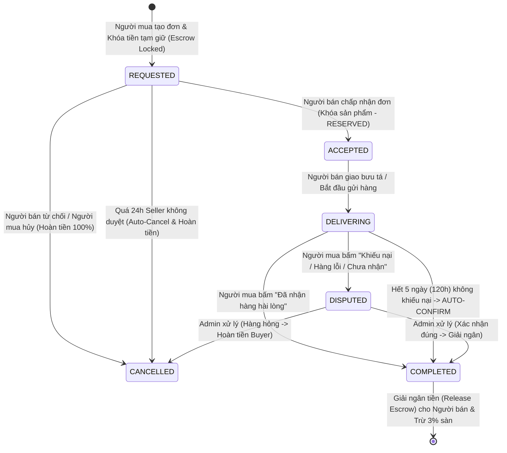

# DỰ ÁN TAKETWO (PHIÊN BẢN NÂNG CẤP V2.0)
## HỆ THỐNG C2C SECONDHAND MARKETPLACE TÍCH HỢP VÍ NỘI BỘ, ESCROW & MÔ HÌNH KINH DOANH DỰA TRÊN TÂM LÝ TIÊU DÙNG

---

# MỤC LỤC
1. [TỔNG HỢP KIẾN THỨC CỐT LÕI DỰ ÁN TAKETWO (EXECUTIVE SUMMARY & FOUNDATION)](#1-tổng-hợp-kiến-thức-cốt-lõi-dự-án-taketwo)
2. [PHÂN TÍCH LỖ HỔNG CỦA HỆ THỐNG CŨ & LÝ DO CẦN ĐỔI MỚI](#2-phân-tích-lỗ-hổng-của-hệ-thống-cũ--lý-do-cần-đổi-mới)
3. [KIẾN TRÚC VÍ ĐIỆN TỬ NỘI BỘ (TAKETWO WALLET) & SỔ CÁI GIAO DỊCH](#3-kiến-trúc-ví-điện-tử-nội-bộ-taketwo-wallet--sổ-cái-giao-dịch)
4. [HỆ THỐNG GÓI ĐẨY BÀI (BOOST/BUMP PACKAGES) THEO COMBO & ĐỊNH GIÁ CHIM MỒI](#4-hệ-thống-gói-đẩy-bài-boostbump-packages-theo-combo--định-giá-chim-mồi)
5. [CƠ CHẾ TẠM GIỮ TIỀN (ESCROW) & CÁC QUY TẮC TỰ ĐỘNG XÁC NHẬN (AUTO-CONFIRMATION SLA)](#5-cơ-chế-tạm-giữ-tiền-escrow--các-quy-tắc-tự-động-xác-nhận-auto-confirmation-sla)
6. [ĐẶC TẢ GIAO DIỆN & MOCKUP CHI TIẾT: THANH TOÁN, SHIP & QUẢN LÝ VÍ](#6-đặc-tả-giao-diện--mockup-chi-tiết-thanh-toán-ship--quản-lý-ví)
7. [MÔ HÌNH KINH DOANH NÂNG CẤP DỰA TRÊN TÂM LÝ HỌC NGƯỜI TIÊU DÙNG (BEHAVIORAL ECONOMICS BMC)](#7-mô-hình-kinh-doanh-nâng-cấp-dựa-trên-tâm-lý-học-người-tiêu-dùng)
8. [CẬP NHẬT CƠ SỞ DỮ LIỆU (DATABASE SCHEMA V2.0)](#8-cập-nhật-cơ-sở-dữ-liệu-database-schema-v20)

---

# 1. TỔNG HỢP KIẾN THỨC CỐT LÕI DỰ ÁN TAKETWO

### 1.1. Tầm nhìn, Sứ mệnh & Định vị
* **Tên dự án:** **TakeTwo** (Cho món đồ một cuộc đời thứ hai).
* **Mô hình hoạt động:** Sàn thương mại điện tử C2C (Customer-to-Customer) chuyên biệt dành cho thị trường đồ cũ (Secondhand) trong cộng đồng sinh viên các trường Đại học tại Hà Nội.
* **Định vị khác biệt:** 
  * Không làm sàn thương mại tổng hợp như Shopee/Lazada (nhiều shop chuyên nghiệp, hàng mới).
  * Không thả nổi như Chợ Tốt hay các hội nhóm Facebook Pass đồ (loạn tin ảo, lừa đảo cọc, hỏi dạo không mua, trôi bài chỉ sau vài phút).
  * TakeTwo tập trung vào **Quy trình mua bán có cấu trúc (Structured C2C Workflow)**, xác minh danh tính sinh viên thông qua Email trường (`.edu.vn`), phân nhóm theo **5 cụm trường Đại học tại Hà Nội** và cơ chế **xác nhận giao dịch minh bạch**.

### 1.2. Thị trường Mục tiêu (Target Market)
* **Quy mô toàn vùng (TAM):** $\approx 1.000.000$ sinh viên tại ~120 trường ĐH/CĐ trên địa bàn Hà Nội. GMV thị trường ước tính $\approx 90 \text{ tỷ VNĐ/năm}$.
* **Trọng tâm khởi đầu (Beachhead Market M1–M6):** Khu đô thị Đại học Hòa Lạc (Đại học FPT, ĐHQGHN với quy mô $\approx 17.166$ sinh viên). Đây là môi trường nội trú khép kín, sinh viên có nhu cầu luân chuyển đồ trọ, giáo trình, đồ gia dụng cực lớn mỗi kỳ.
* **4 Ngành hàng cốt lõi:**
  1. *Giáo trình & Tài liệu học tập (`Books`)*: Slide, sách chuyên ngành, đề thi mẫu, giáo trình đại cương.
  2. *Đồ dùng phòng trọ & KTX (`Living`)*: Nồi cơm điện, quạt, bàn gấp, giá sách, ấm siêu tốc, tủ vải.
  3. *Điện tử & Phụ kiện (`Electronics`)*: Chuột, bàn phím, tai nghe, màn hình máy tính, dây cáp sạc.
  4. *Thời trang & Phụ kiện SV (`Fashion`)*: Áo khoác đồng phục, vest thuyết trình, quần áo pass đồ mùa mới.

### 1.3. Nghiên cứu & Dữ liệu Khảo sát thực tế ($N = 50$ & $N = 323$)
* **Tỷ lệ tham gia:** Hơn **91%** sinh viên đã từng mua hoặc bán đồ cũ (45,8% vừa mua vừa bán).
* **Động lực chính:** **89,5%** sinh viên tìm đến đồ cũ vì mục tiêu **tiết kiệm chi phí sinh hoạt**.
* **Các điểm đau lớn nhất của Người mua (Buyer Pain Points):**
  * Sợ bị lừa đảo cọc / hàng giả, không đúng mô tả: **58,4%**.
  * Thông tin sản phẩm mù mờ, thiếu ảnh chụp thật hoặc khuyết điểm: **55,4%**.
  * Mất thời gian nhắn tin hỏi dạo (còn không, ship thế nào, giá fix không): **50,2%**.
  * Không rõ uy tín của người bán: **34,9%**.
* **Các điểm đau lớn nhất của Người bán (Seller Pain Points):**
  * Đăng bài trên nhóm Facebook bị trôi tin quá nhanh: **60,2%**.
  * Người nhắn tin hỏi giá, hỏi dạo rồi "bốc hơi" (Ghosting): **51,7%**.
  * Phải trả lời lặp đi lặp lại những câu hỏi cơ bản: **41,1%**.

### 1.4. Đội ngũ & Ngân sách MVP ban đầu
* **Team 5 thành viên:** Huy (BA / Product & Strategy), Hùng (Market, Research & GTM), Bình (Business Model & Finance), Phú (Operations, Legal & Moderation), Tuấn (System Architecture & Full-stack Tech).
* **Ngân sách thực tế ban đầu:** **$30.250.000 \text{ VNĐ}$** (gồm $8$tr phát triển phần mềm, $6,5$tr máy chủ CSDL, $8$tr bảo trì vận hành pháp lý, $5$tr truyền thông trường và $2,75$tr dự phòng).

---

# 2. PHÂN TÍCH LỖ HỔNG CỦA HỆ THỐNG CŨ & LÝ DO CẦN ĐỔI MỚI

Khi đem mô hình cũ đi trình bày trước hội đồng và người dùng thực tế, hệ thống đã bộc lộ **4 rào cản nghiêm trọng (Critical Bottlenecks)**:

```
[MÔ HÌNH CŨ - NHIỀU MA SÁT]
Đăng bài -> Chat -> Hẹn gặp -> Tự chuyển khoản ngoài -> Tự xác nhận thủ công
  ⚠️ Rủi ro bùng cọc / Scam         ⚠️ Phí đẩy bài 15k phải chuyển lẻ từng lần
  ⚠️ Thiếu luồng Ship & Tracking    ⚠️ Không có bên trung gian giữ tiền (Escrow)
```

1. **Ma sát thanh toán đẩy bài (15.000đ/lần):** Người bán muốn đẩy bài viết lên đầu trang tìm kiếm nhưng mỗi lần bấm đẩy lại phải quét mã QR chuyển khoản 15k ở ngân hàng. Quá trình này ngắt quãng trải nghiệm (high checkout friction), khiến người bán nản lòng và từ bỏ tính năng trả phí này.
2. **Thanh toán thả nổi ngoài nền tảng (Off-platform Payment):** Hệ thống chỉ dừng ở việc "tạo cầu nối" (match-making) và xác nhận miệng. Việc chuyển tiền vẫn tự làm ở ngoài khiến TakeTwo:
   * Không thể bảo vệ người mua nếu người bán gửi hàng hỏng hoặc "ôm tiền biến mất".
   * Không thể thu được phí hoa hồng 3% một cách tự động và minh bạch.
3. **Thiếu cơ chế Tạm giữ (Escrow) & Đồng hồ tự động:** Nếu người mua nhận hàng nhưng quên hoặc cố tình không bấm "Đã nhận hàng", người bán bị giam hàng mà không lấy được tiền. Ngược lại, nếu người mua chuyển tiền trước mà người bán không gửi hàng, người mua mất trắng.
4. **Thiếu hoàn toàn màn hình Mockup luồng Ship & Thanh toán:** Bản thiết kế giao diện trước đây chỉ dừng lại ở trang hiển thị sản phẩm và khung chat, hoàn toàn thiếu các bước: chọn địa chỉ giao nhận (KTX/Trọ), chọn bên vận chuyển, hiển thị phí ship, theo dõi mã tracking và giao diện quản lý dòng tiền cá nhân.

---

# 3. KIẾN TRÚC VÍ ĐIỆN TỬ NỘI BỘ (TAKETWO WALLET) & SỔ CÁI GIAO DỊCH

Để loại bỏ hoàn toàn việc "chuyển khoản lẻ 15.000đ phiền phức", TakeTwo triển khai **Ví điện tử nội bộ (In-app Prepaid Wallet)**.

```
       [Tài khoản Ngân hàng / MoMo / VNPay của Sinh viên]
                           │  ▲
           Nạp tiền 1 lần  │  │ Rút tiền về (Payout)
         (50k, 100k, 200k) │  │
                           ▼  │
┌─────────────────────────────────────────────────────────────┐
│                    VÍ NỘI BỘ TAKETWO                        │
│                                                             │
│  ┌────────────────────────┐     ┌────────────────────────┐  │
│  │   SỐ DƯ KHẢ DỤNG       │     │   SỐ DƯ TẠM GIỮ        │  │
│  │  (Available Balance)   │     │      (Escrow Hold)     │  │
│  │  • Dùng mua hàng       │     │  • Tiền mua hàng được  │  │
│  │  • Mua gói đẩy bài     │     │    khóa lại cho đến    │  │
│  │  • Rút về ngân hàng    │     │    khi nhận hàng 5 ngày│  │
│  └───────────┬────────────┘     └───────────▲────────────┘  │
│              │                              │               │
│              └─────── Khi bấm Đặt mua ──────┘               │
└─────────────────────────────────────────────────────────────┘
```

### 3.1. Nguyên lý vận hành của Ví TakeTwo
1. **Một lần nạp – Đa mục đích sử dụng (Top-up Once, Spend Anywhere):**
   * Sinh viên chỉ cần nạp tiền một lần qua mã QR động (VietQR liên kết SeABank/MBBank hoặc MoMo/VNPay API) với các mệnh giá chuẩn: **50.000đ**, **100.000đ**, **200.000đ**, **500.000đ**.
   * Tiền vào ví ngay lập tức trong vòng 3 – 5 giây qua Webhook thông minh.
2. **Hai ngăn tài khoản trong một ví:**
   * **Ngăn 1: Số dư khả dụng (`available_balance`):** Dùng để mua hàng ngay lập tức chỉ với 1 cú click (1-Click Checkout), mua các gói đẩy tin mà không cần mở app ngân hàng, hoặc yêu cầu rút tiền về ngân hàng.
   * **Ngăn 2: Số dư tạm giữ (`escrow_balance`):** Khi người mua bấm "Mua hàng", tiền từ số dư khả dụng của Buyer được chuyển vào trạng thái Khóa (Escrow). Tiền này không ai được rút cho đến khi đơn hàng hoàn tất hợp lệ.
3. **Cơ chế Sổ cái Kép (Double-entry Ledger) bảo đảm toàn vẹn:**
   * Mỗi biến động tài chính đều tạo một bản ghi giao dịch (`WalletTransaction`) với mã tham chiếu duy nhất, loại giao dịch (`TOPUP`, `BUMP_PURCHASE`, `ESCROW_HOLD`, `ESCROW_RELEASE`, `WITHDRAW`, `REFUND`), số dư trước và số dư sau giao dịch. Đảm bảo chống thất thoát số dư.

### 3.2. Bảng Phân loại Giao dịch Ví
| Loại Giao dịch | Hướng dòng tiền | Ý nghĩa nghiệp vụ |
| :--- | :---: | :--- |
| `TOPUP` | $+$ Khả dụng | Nạp tiền từ ngân hàng bên ngoài vào ví qua VietQR. |
| `BUMP_PAYMENT` | $-$ Khả dụng | Mua lẻ hoặc mua gói đẩy tin (trừ tiền tức thì). |
| `BUYER_ESCROW_HOLD`| $-$ Khả dụng $\rightarrow$ $+$ Escrow | Khóa tiền đặt mua đơn hàng chờ giao nhận. |
| `SELLER_ESCROW_RECEIVE`| $+$ Khả dụng (Seller) | Giải phóng tiền từ Escrow vào ví người bán sau khi hoàn tất. |
| `BUYER_REFUND` | $+$ Khả dụng (Buyer) | Trả lại tiền tạm giữ cho người mua khi đơn bị hủy hoặc lỗi. |
| `COMMISSION_DEDUCT` | $-$ Tiền chuyển | Hệ thống khấu trừ 3% hoa hồng sàn trước khi trả cho người bán. |
| `WITHDRAWAL` | $-$ Khả dụng | Rút tiền từ ví TakeTwo về tài khoản ngân hàng chính chủ. |

---

# 4. HỆ THỐNG GÓI ĐẨY BÀI (BOOST/BUMP PACKAGES) THEO COMBO & ĐỊNH GIÁ CHIM MỒI

Thay vì chỉ có mức giá 15.000đ cho mỗi lần đẩy bài gây ức chế, TakeTwo áp dụng chiến lược **Gói đẩy bài (Bump Credits Bundle)** tích hợp trừ trực tiếp qua Ví:

### 4.1. Bảng Thiết kế 3 Gói Đẩy Tin (Chuẩn Hóa Theo Đề Xuất & Tâm Lý Tiết Kiệm)
| Tên Gói | Số Lượt Đẩy | Đơn Giá / Lượt | Tổng Giá Bán | Quyền Lợi Đi Kèm | Tâm Lý Áp Dụng |
| :--- | :---: | :---: | :---: | :--- | :--- |
| **Gói Lẻ (Cơ bản)** | 1 lượt | $15.000 \text{ đ}$ | **$15.000 \text{ đ}$** | 1 lượt đẩy bài viết lên vị trí Top 1 danh mục. | **Mức giá neo (Anchor Price):** Làm nổi bật giá trị tiết kiệm của các gói combo. |
| **Gói Sinh Viên Tiết Kiệm (Khuyên dùng)** | 5 lượt | $9.800 \text{ đ}$ | **$49.000 \text{ đ}$** | 5 lượt đăng & đẩy bài linh hoạt trong 30 ngày. **Tiết kiệm 35%** (26.000đ). | **Hiệu ứng chim mồi (Decoy Effect):** Thêm 34k so với gói lẻ mà được tận 5 lượt (chỉ 9.8k/lượt). |
| **Gói Xả Đồ Ra Trường (VIP)** | 10 lượt | $7.900 \text{ đ}$ | **$79.000 \text{ đ}$** | 10 lượt đẩy Top + Tặng **Huy hiệu "🔥 Đẩy Top"** rực rỡ và viền thẻ cam nổi bật. | **Siêu hời - Pass nhanh x3:** Phù hợp sinh viên tốt nghiệp, dọn phòng KTX cần pass sỉ đồ gấp. |

### 4.2. Trải nghiệm Người dùng (1-Click Bump)
* Khi người bán đang có số dư ví $\ge$ giá trị gói: Bấm `Đẩy bài ngay` $\rightarrow$ Popup chọn gói $\rightarrow$ Bấm `Xác nhận` $\rightarrow$ Trừ tiền trong 0,5 giây, bài nhảy lên vị trí Top 1 tìm kiếm ngay lập tức mà không cần chuyển khoản thẻ ngân hàng.

---

# 5. CƠ CHẾ TẠM GIỮ TIỀN (ESCROW) & CÁC QUY TẮC TỰ ĐỘNG XÁC NHẬN (AUTO-CONFIRMATION SLA)

Để loại bỏ vấn đề "bùng cọc", "ôm tiền biến mất" hoặc "nhận hàng xong không chịu bấm xác nhận", hệ thống vận hành **Cơ chế Escrow & Bộ đếm thời gian tự động (Auto-confirmation State Machine)**.



### 5.1. Quy tắc Tự động Xác nhận 5 Ngày (5-Day Auto-Confirmation Rule)
* **Kích hoạt:** Ngay khi Người bán cập nhật trạng thái `Đã gửi hàng` (hoặc bưu tá đối tác quét trạng thái `Đã giao hàng thành công`), hệ thống kích hoạt **Đồng hồ đếm ngược 120 giờ (5 ngày)**.
* **Quyền hạn của Người mua trong 5 ngày:**
  1. *Nếu hài lòng:* Bấm nút `Đã nhận hàng & Hoàn tất` $\rightarrow$ Hệ thống giải phóng tiền tạm giữ ngay lập tức sang số dư khả dụng của Người bán (trừ 3% phí sàn).
  2. *Nếu có sự cố (hàng bể vỡ, không đúng như ảnh mô tả, chưa nhận được):* Bấm nút `Yêu cầu Khiếu nại / Trả hàng`. Hệ thống sẽ **đóng băng đồng hồ 5 ngày**, chuyển đơn sang trạng thái `DISPUTED` và thông báo tới Admin TakeTwo để đối soát bằng chứng ảnh/video.
* **Kịch bản Tự động (Auto-Confirm Action):**
  * Nếu sau **chính xác 120 giờ (5 ngày)**, Người mua không bấm xác nhận và cũng **không gửi khiếu nại**, hệ thống hiểu rằng giao dịch đã diễn ra êm đẹp.
  * Hệ thống tự động chuyển trạng thái đơn sang `COMPLETED_AUTO`, tự động giải ngân toàn bộ số tiền vào Ví khả dụng của Người bán, ghi nhận $+1$ vào North Star Metric và gửi thông báo chúc mừng cả hai bên.

### 5.2. Các Quy tắc SLA Tự động hóa Khác (System Timeouts)
1. **Quy tắc Quá hạn Duyệt đơn (24h Seller Acceptance Timeout):** Người mua đặt cọc/chuyển tiền giữ chỗ. Nếu sau 24 giờ Người bán không bấm "Chấp nhận giao dịch", đơn hàng tự động bị hủy (`AUTO_CANCEL`), toàn bộ tiền cọc được hoàn trả 100% về ví Người mua ngay lập tức.
2. **Quy tắc Quá hạn Giao hàng (48h Shipping Timeout):** Sau khi Người bán chấp nhận đơn, nếu trong vòng 48 giờ Người bán không nhập mã vận đơn hoặc không bấm "Đã gửi hàng", Người mua có quyền bấm "Hủy đơn lấy lại tiền" mà không cần sự đồng ý của Người bán.

---

# 6. ĐẶC TẢ GIAO DIỆN & MOCKUP CHI TIẾT: THANH TOÁN, SHIP & QUẢN LÝ VÍ

Giao diện được thiết kế hiện đại, tinh gọn: Dữ liệu tài chính trực quan, nhấn mạnh vào các thẻ trạng thái (Status Badges), tương thích hoàn hảo trên cả Mobile Web và Desktop.

---

### MOCKUP 1: MÀN HÌNH THANH TOÁN & ĐẶT MUA (CHECKOUT SCREEN)
```
┌────────────────────────────────────────────────────────────────────────┐
│  ← Quay lại | 🛒 THANH TOÁN AN TOÀN QUA TAKETWO ESCROW                 │
├────────────────────────────────────────────────────────────────────────┤
│  📦 THÔNG TIN SẢN PHẨM                                                 │
│  ┌──────────┬────────────────────────────────────────────────────────┐ │
│  │  [ẢNH]   │ Giáo trình Triết học Mác - Lênin (Tái bản 2024)       │ │
│  │          │ Tình trạng: Như mới 99% | Người bán: Lan Anh (FPTU)    │ │
│  │          │ Giá niêm yết: 45.000 đ                                 │ │
│  └──────────┴────────────────────────────────────────────────────────┘ │
├────────────────────────────────────────────────────────────────────────┤
│  🚚 HÌNH THỨC GIAO NHẬN                                                │
│  ( ) Hẹn gặp trực tiếp tại Campus (Miễn phí)                           │
│      Điểm hẹn gợi ý: Trống Đồng KTX Dom A - ĐH FPT Hòa Lạc             │
│  (•) Giao tận nơi qua Bưu cục / Bưu tá (+ 15.000 đ)                   │
│      📍 Địa chỉ nhận hàng: Phòng 304, Dom E, KTX ĐHQG Hòa Lạc          │
│      👤 Người nhận: Trần Minh Huy - 0987.xxx.xxx                      │
├────────────────────────────────────────────────────────────────────────┤
│  💳 PHƯƠNG THỨC THANH TOÁN TIỀN HÀNG                                   │
│  (•) Ví điện tử TakeTwo (Khuyên dùng - Khóa tiền an toàn)              │
│      Số dư khả dụng hiện tại: 120.000 đ [ĐỦ THANH TOÁN]                │
│  ( ) Quét mã VietQR động (Ngân hàng / MoMo)                           │
│  🛡️ CAM KẾT TAKETWO SHIELD: Tiền được giữ an toàn 100% trong 5 ngày.   │
│     Người bán CHƯA nhận được tiền cho đến khi bạn xác nhận hài lòng.   │
├────────────────────────────────────────────────────────────────────────┤
│  CHI TIẾT THANH TOÁN:                                                  │
│  • Tiền hàng:                 45.000 đ                                 │
│  • Phí vận chuyển nội khu:    15.000 đ                                 │
│  • Giảm giá sinh viên:        - 5.000 đ                                │
│  ──────────────────────────────────────                                │
│  TỔNG CỘNG THANH TOÁN:        55.000 đ                                 │
│                                                                        │
│  [  🔒 XÁC NHẬN THANH TOÁN & GIỮ CHỖ HÀNG (55.000 Đ)  ]                │
└────────────────────────────────────────────────────────────────────────┘
```

---

### MOCKUP 2: MÀN HÌNH THEO DÕI VẬN CHUYỂN & ĐẾM NGƯỢC XÁC NHẬN 5 NGÀY
```
┌────────────────────────────────────────────────────────────────────────┐
│  MÃ ĐƠN HÀNG: #TK-20261102-88 | Trạng thái: 🚚 ĐANG VẬN CHUYỂN         │
├────────────────────────────────────────────────────────────────────────┤
│  ⏳ ĐỒNG HỒ BẢO VỆ NGƯỜI MUA: CÒN 3 NGÀY 14 GIỜ NỮA                    │
│  "Hệ thống sẽ tự động hoàn tất và chuyển tiền cho Người bán nếu bạn   │
│   không có khiếu nại trước 18:00 ngày 07/11/2026"                      │
├────────────────────────────────────────────────────────────────────────┤
│  📍 HÀNH TRÌNH ĐƠN HÀNG:                                               │
│  [✓] 02/11 08:30 - Người mua đã đặt hàng & Khóa tiền Escrow           │
│  [✓] 02/11 09:15 - Người bán Lan Anh đã duyệt đơn & Đóng gói hàng      │
│  [•] 02/11 11:00 - Bưu tá đã lấy hàng (Mã vận đơn: FPT-SHIP-99182)    │
│  [ ] Dự kiến giao: Chiều nay trước 17:00 tại Sảnh Dom E                │
├────────────────────────────────────────────────────────────────────────┤
│  HÀNH ĐỘNG DÀNH CHO BẠN:                                               │
│                                                                        │
│  ┌──────────────────────────────────────────────────────────────────┐  │
│  │  [ ✅ ĐÃ NHẬN ĐƯỢC HÀNG & HÀI LÒNG ]                              │  │
│  │  (Bấm vào đây để chuyển tiền ngay cho người bán & đánh giá sao)   │  │
│  └──────────────────────────────────────────────────────────────────┘  │
│                                                                        │
│  [ ⚠️ Yêu cầu Khiếu nại / Chưa nhận được hàng / Hàng lỗi ]             │
└────────────────────────────────────────────────────────────────────────┘
```

---

### MOCKUP 3: TRUNG TÂM QUẢN LÝ VÍ TAKETWO & LỊCH SỬ DÒNG TIỀN
```
┌────────────────────────────────────────────────────────────────────────┐
│  👤 VÍ ĐIỆN TỬ TAKETWO — VŨ HÁN TUẤN (tuanvhhe194875)                  │
├────────────────────────────────────────────────────────────────────────┤
│  ┌─────────────────────────────────┬─────────────────────────────────┐ │
│  │  SỐ DƯ KHẢ DỤNG                 │  SỐ DƯ TẠM GIỮ (ESCROW)         │ │
│  │  165.000 đ                      │  55.000 đ                       │ │
│  │  [ + NẠP TIỀN ]  [ ⤓ RÚT TIỀN ] │  (Đang giữ ở đơn hàng #TK-88)   │ │
│  └─────────────────────────────────┴─────────────────────────────────┘ │
├────────────────────────────────────────────────────────────────────────┤
│  ⚡ TIỆN ÍCH DÀNH CHO BẠN:                                             │
│  [ 🚀 Mua Gói Đẩy Tin (Từ 35k) ]    [ 🏷️ Mã giảm giá của tôi ]         │
├────────────────────────────────────────────────────────────────────────┤
│  📜 LỊCH SỬ GIAO DỊCH GẦN ĐÂY                                          │
│  ┌──────────┬───────────────────┬──────────────┬─────────────────────┐ │
│  │ THỜI GIAN│ LOẠI GIAO DỊCH    │ SỐ TIỀN      │ TRẠNG THÁI          │ │
│  ├──────────┼───────────────────┼──────────────┼─────────────────────┤ │
│  │ 02/11 10h│ Đặt mua đơn #TK-88│ - 55.000 đ   │ 🔒 Tạm giữ Escrow   │ │
│  │ 01/11 15h│ Mua Gói Booster 3 │ - 35.000 đ   │ ✅ Thành công       │ │
│  │ 01/11 14h│ Nạp tiền VietQR   │ + 200.000 đ  │ ✅ Hoàn tất         │ │
│  │ 28/10 09h│ Bán Bàn học gấp   │ + 77.600 đ   │ ✅ Đã cộng ví (3%)  │ │
│  └──────────┴───────────────────┴──────────────┴─────────────────────┘ │
└────────────────────────────────────────────────────────────────────────┘
```

---

# 7. MÔ HÌNH KINH DOANH NÂNG CẤP DỰA TRÊN TÂM LÝ HỌC NGƯỜI TIÊU DÙNG

Áp dụng các nguyên lý cốt lõi của **Kinh tế học Hành vi (Behavioral Economics)** và **Tâm lý học Tiêu dùng Sinh viên Gen Z** để thúc đẩy thanh khoản sàn và tăng doanh thu tự nhiên:

### 7.1. Sáu Đòn bẩy Tâm lý Học Hành vi (Behavioral Levers)
1. **Loss Aversion (Tâm lý Sợ Mất Mát) $\rightarrow$ Lá Chắn Escrow & Đảm bảo Hoàn Tiền:**
   * Nghiên cứu tâm lý học của Kahneman & Tversky chỉ ra: *Nỗi đau khi mất 100k lớn gấp đôi niềm vui khi kiếm được 100k*. Khảo sát chỉ ra 58,4% sinh viên sợ bị lừa.
   * *Ứng dụng:* Thay vì bảo "hãy mua hàng đi", TakeTwo định vị bằng thông điệp: *"Tiền của bạn được đóng băng an toàn 100% trong két sắt TakeTwo. Nếu người bán giao sai hoặc biến mất, bạn được hoàn tiền chỉ trong 1 chạm"*. Điều này xóa bỏ hoàn toàn rào cản sợ hãi.
2. **Pain of Paying (Nỗi Đau Thanh Toán) & Mental Accounting (Kế Toán Tâm Trí):**
   * Mỗi lần chuyển khoản ngân hàng lẻ tẻ 15.000đ là một lần não bộ người dùng chịu cảm giác "bị mất tiền", kèm thao tác mở app ngân hàng phiền phức.
   * *Ứng dụng:* Cơ chế nạp ví 100k/200k biến số dư thành "điểm số trong ứng dụng". Khi đã nạp tiền vào ví, sinh viên xem số dư đó là "ngân sách mua sắm/bán hàng đã được trích lập sẵn". Bấm mua gói đẩy bài 35k hoặc 49k chỉ tốn 1 cú nhấp chuột, không hề kích hoạt cảm giác đau ví như chuyển khoản lẻ.
3. **Decoy Effect (Hiệu Ứng Chim Mồi) $\rightarrow$ Định Giá Gói Đẩy Bài:**
   * Đặt gói 1 lượt giá **$15.000\text{đ}$**, gói 3 lượt giá **$35.000\text{đ}$** ($11.600\text{đ}$/lượt), và gói 5 lượt giá **$49.000\text{đ}$** ($9.800\text{đ}$/lượt kèm huy hiệu Hot).
   * Gói 1 lượt đóng vai trò "chim mồi". Người dùng nhìn vào sẽ thấy gói 5 lượt quá hời (chỉ thêm 14k so với gói 3 lượt mà được thêm 2 lượt đẩy và nhãn nổi bật), từ đó kích hoạt hành vi chọn gói $49.000\text{đ}$ chiếm tới $\approx 60\%$ lựa chọn.
4. **Scarcity & Urgency (Tâm lý Khan Hiếm & Bộ Đếm Thời Gian):**
   * Trên trang chi tiết sản phẩm hiển thị: *"Đang có 4 bạn sinh viên khác đang xem món đồ này"*.
   * Trong giao dịch vận chuyển: Bộ đếm ngược 5 ngày tạo cảm giác minh bạch, thúc đẩy người mua phản hồi sớm để nhận quà tri ân.
5. **Sunk Cost Fallacy (Tâm lý Chi Phí Chìm) & Gamification (Trò Chơi Hóa):**
   * Tặng ngay **$10.000\text{đ}$** mã giảm giá vào ví cho người dùng mới khi xác thực email trường (`.edu.vn`). Số tiền này không được rút mà chỉ được trừ khi mua đơn hàng đầu tiên $\ge 50.000\text{đ}$.
   * Người dùng có tâm lý: *"Đang có sẵn 10k trong ví, nếu không dùng sẽ phí phạm"*, từ đó nhanh chóng tìm đồ cũ để mua đơn hàng đầu tiên.
6. **Eco-Pride & Frugality Identity (Tâm lý Tự Hào Sống Xanh & Tiết Kiệm):**
   * Gen Z đặc biệt quan tâm tới lối sống bền vững (Sustainability).
   * Trên trang hồ sơ cá nhân hiển thị huy hiệu: *"Minh Huy đã tái chế 4 món đồ, tiết kiệm $420.000\text{đ}$ và giảm $12\text{kg}$ rác thải cho KTX Hòa Lạc"*. Biến việc mua đồ cũ thành một hành động thời thượng, đáng tự hào để chia sẻ lên Story Instagram/Facebook.

---

### 7.2. Business Model Canvas (BMC) Phiên bản 2.0 Nâng cấp
| Khối Mô Hình | Nội Dung Chi Tiết (Phiên bản V2.0 Tích hợp Ví & Escrow) |
| :--- | :--- |
| **Phân Khúc Khách Hàng (Customer Segments)** | • Sinh viên cần thanh lý đồ chuyển trọ / đổi giáo trình.<br>• Sinh viên muốn săn đồ tốt giá rẻ, tiết kiệm chi phí.<br>• Cộng tác viên / Sinh viên kinh doanh đồ cũ KTX. |
| **Tuyên Bố Giá Trị (Value Propositions)** | • Giao dịch đồ cũ an toàn 100% nhờ Ví Escrow bảo vệ 5 ngày.<br>• Đẩy bài tức thì bằng 1 click qua số dư ví, không cần chuyển khoản 15k lắt nhắt.<br>• Mua bán chuẩn hóa, phân vùng 5 cụm trường, không sợ trôi bài hay hỏi dạo. |
| **Dòng Doanh Thu (Revenue Streams)** | 1. **Bán Gói Đẩy Bài (Boost Bundles):** 15.000đ, 49.000đ, 79.000đ (chiếm 65% doanh thu).<br>2. **Phí Giao Dịch Sàn (Escrow Commission):** Khấu trừ tự động 3% trên giá trị đơn hàng thực tế.<br>3. **Phí Xử lý Rút tiền (Withdrawal Fee):** Miễn phí lần đầu/tháng, 2.000đ từ lần 2. |
| **Kênh Phân Phối (Channels)** | • Web App Responsive tối ưu di động.<br>• Hội nhóm KTX Dom A-B-C-D-E, Group sinh viên Hòa Lạc, Bách Kinh Xây.<br>• Đại sứ sinh viên tại các cụm trường (Campus Ambassadors). |
| **Chi Phí Cốt Lõi (Cost Structure)** | • Chi phí cổng thanh toán & hạ tầng máy chủ Webhook VietQR (~1.5% phí nạp).<br>• Chi phí vận hành, bảo mật CSDL & đội kiểm duyệt tranh chấp.<br>• Chi phí khuyến mãi nạp ví và voucher kích hoạt tài khoản ban đầu. |

---

# 8. CẬP NHẬT CƠ SỞ DỮ LIỆU (DATABASE SCHEMA V2.0)

Để phục vụ kiến trúc ví, combo đẩy tin và tự động hóa escrow 5 ngày, CSDL được bổ sung 3 thực thể mới và nâng cấp 2 thực thể hiện có:

### 8.1. Các Bảng Cơ Sở Dữ Liệu Thực Tế (SQLite in Node.js)
1. **`wallets` (Ví Người Dùng):**
   * `id (INTEGER PK AUTOINCREMENT)`
   * `user_id (INTEGER FK -> users, UNIQUE)`
   * `balance (INTEGER DEFAULT 0)` — Số dư khả dụng (VNĐ)
   * `escrow_balance (INTEGER DEFAULT 0)` — Số dư đang tạm giữ trong két Escrow
   * `boost_credits (INTEGER DEFAULT 0)` — Số lượt đẩy bài VIP còn lại
   * `updated_at (TEXT)`
2. **`transactions` (Sổ cái Lịch sử Dòng Tiền):**
   * `id (INTEGER PK AUTOINCREMENT)`
   * `tx_code (TEXT)` — Mã tham chiếu duy nhất (VD: `TX-10081`)
   * `wallet_id (INTEGER FK -> wallets)`
   * `user_id (INTEGER FK -> users)`
   * `type (TEXT)` — `TOPUP`, `POST_FEE`, `BUY_BOOST`, `USE_BOOST`, `ORDER_PAYMENT`, `ORDER_PAYOUT`
   * `type_label (TEXT)` — 'Nạp tiền nhanh', 'Phí đẩy bài lẻ', 'Mua gói đẩy bài', 'Thanh toán đơn hàng', 'Nhận tiền bán hàng'
   * `amount (INTEGER)` — Số tiền (+/-)
   * `balance_after (INTEGER)` — Số dư sau biến động
   * `description (TEXT)`
   * `status (TEXT)` — `SUCCESS`, `HOLDING`
   * `created_at (TEXT)`
3. **`bump_packages` (3 Gói Đẩy Tin Chuẩn Tâm Lý Học):**
   * `id (TEXT PK)` — `bump_single`, `bump_saver`, `bump_vip`
   * `name (TEXT)` — "Gói Lẻ (Cơ bản)", "Gói Sinh Viên Tiết Kiệm", "Gói Xả Đồ Ra Trường (VIP)"
   * `credits (INTEGER)` — 1 lượt, 5 lượt, 10 lượt
   * `price (INTEGER)` — 15.000đ, 49.000đ, 79.000đ
   * `tag (TEXT)` — 'Mức giá neo', 'Phổ biến nhất - Tiết kiệm 35%', 'Siêu hời - Pass nhanh x3'
   * `is_popular (INTEGER)` — Gắn cờ gói khuyên dùng
   * `has_badge_hot (INTEGER)` — Tặng huy hiệu "🔥 Đẩy Top"
4. **`orders` (Đơn Hàng Vận Chuyển & Két Escrow):**
   * `id (INTEGER PK AUTOINCREMENT)`
   * `order_code (TEXT UNIQUE)` — Mã đơn (VD: `TK-20261102-01`)
   * `product_id (INTEGER FK -> products)`
   * `buyer_id (INTEGER FK -> users)`
   * `seller_id (INTEGER FK -> users)`
   * `product_price (INTEGER)`
   * `shipping_fee (INTEGER)` — 0đ (Gặp trực tiếp), 15.000đ (Ship KTX), 25.000đ (Giao nhanh)
   * `total_amount (INTEGER)` — `product_price + shipping_fee`
   * `delivery_type (TEXT)` — `CAMPUS`, `ROOM`, `EXPRESS`
   * `delivery_type_label (TEXT)`
   * `delivery_address (TEXT)`
   * `recipient_name (TEXT)`
   * `recipient_phone (TEXT)`
   * `status (TEXT)` — `SHIPPING`, `COMPLETED`, `AUTO_COMPLETED`
   * `escrow_status (TEXT)` — `HELD`, `RELEASED`
   * `auto_confirm_deadline (TEXT)` — Mốc thời gian 5 ngày tự động giải ngân
   * `created_at (TEXT)`, `completed_at (TEXT)`
